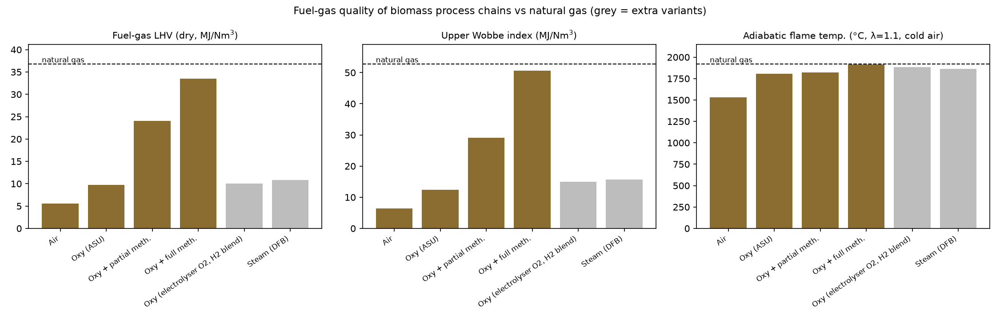
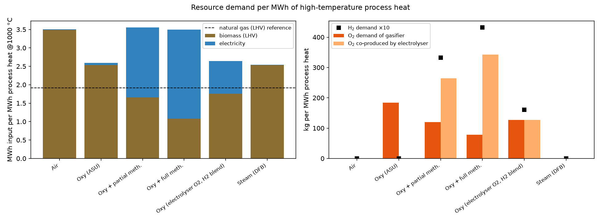
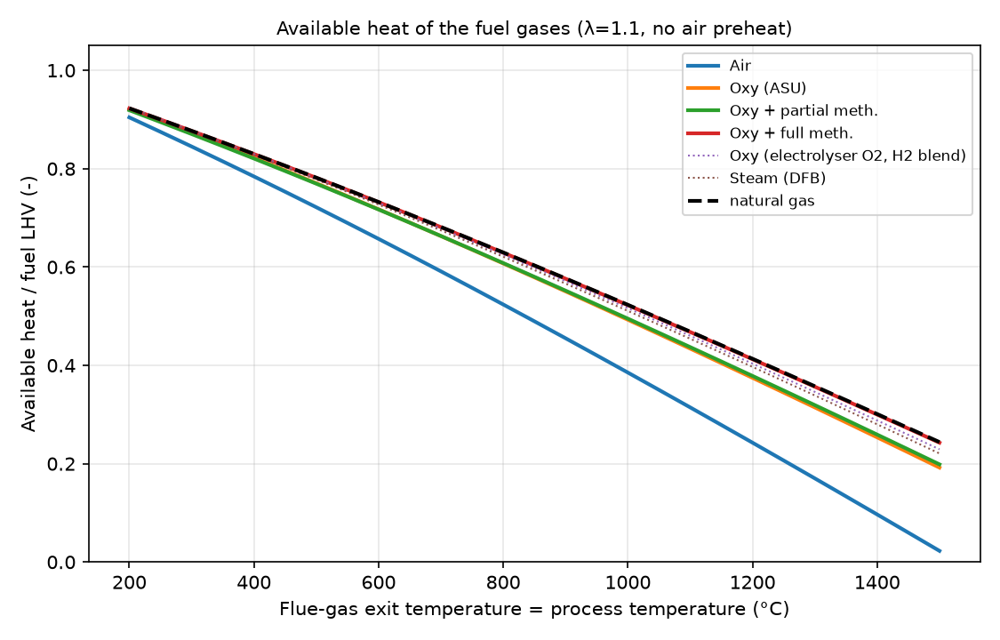

# biomass-heat-plant-model

Modular **agent-based plant model** for biomass gasification process chains that replace
natural gas in **industrial high-temperature process heat**: air gasification, oxyfuel
(O2/steam) gasification with no, partial or full methanation, electrolysis for H2 (and O2),
H2/O2 storage, a burner/furnace and an electricity market agent.

Part of the project **[Biomass Process Heat](https://github.com/DataWithSyed/biomass-process-heat)**
(step 2 of the roadmap). Later repos (dispatch, LCOH, scenarios, dashboard) install this
package and reuse its agents.

## Problem

Natural gas burners deliver most industrial heat above ~500 degC. Biogenic syngas from
thermochemical gasification can replace it, but its quality depends strongly on the process
chain: air-blown gas is diluted by nitrogen, oxyfuel gas needs oxygen, and methanation needs
hydrogen. How much biomass, electricity, O2 and H2 does each chain need per MWh of useful
heat at a given process temperature, and how close does the fuel get to natural gas?

## Method

* **Agents** (`src/biomass_heat/agents.py`): `BiomassFeed`, `Gasifier` (air / oxyfuel /
  allothermal steam DFB), `GasCleaning`, `Methanation` (none / partial / full),
  `Electrolyser`, `GasStorage` (H2, O2), `AirSeparationUnit`, `Burner`,
  `ProcessHeatDemand`, `GridMarket`. Each has its own parameters, state and ledger.
* **Scheduler** (`plant.py`): wires the agents, sizes the chain for a heat duty
  (`design_point`) or steps hourly through a demand and price series (`simulate`) with a
  pluggable electrolyser operating strategy and storages.
* **Physics**: elemental C/H/O/N balances; quasi-equilibrium gasifier (water-gas shift at
  outlet temperature, fixed non-equilibrium CH4 yield, autothermal oxidant flow from the
  energy balance); two-reaction methanation equilibrium (cross-checked against Cantera
  during development); syngas cooling and condensation; isentropic compression; complete
  combustion with adiabatic flame temperature and **available heat at the process
  temperature**. Thermodynamic data: NASA polynomials from GRI-Mech 3.0.
* Details: [docs/model.md](docs/model.md). All parameters: [docs/assumptions.md](docs/assumptions.md).

## Key results (reference design point: 10 MW process heat at 1000 degC)

| Configuration | CGE | Fuel LHV (MJ/Nm3) | Wobbe (MJ/Nm3) | T_ad (degC) | Avail. heat | Biomass MWh/MWh_heat | Electricity MWh/MWh_heat | O2 kg/MWh_heat | H2 kg/MWh_heat |
|---|---|---|---|---|---|---|---|---|---|
| Air gasification | 0.745 | 5.53 | 6.43 | 1530 | 0.385 | 3.49 | 0.019 | 0 | 0 |
| Oxyfuel, no methanation (O2 from ASU) | 0.800 | 9.72 | 12.5 | 1807 | 0.493 | 2.54 | 0.055 | 184 | 0 |
| Oxyfuel + partial methanation (50 % H2) | 0.800 | 24.1 | 29.0 | 1822 | 0.495 | 1.66 | 1.90 | 120 | 33.2 |
| Oxyfuel + full methanation | 0.800 | 33.5 | 50.6 | 1916 | 0.522 | 1.08 | 2.42 | 78 | 43.2 |
| *Variant: oxyfuel, O2 from electrolyser, H2 blended* | 0.800 | 10.0 | 14.9 | 1882 | 0.516 | 1.75 | 0.89 | 127 | 16.0 |
| *Variant: allothermal steam (DFB)* | 0.772 | 10.8 | 15.7 | 1865 | 0.511 | 2.54 | 0.008 | 0 | 0 |
| Natural gas (reference composition) | - | 36.8 | 52.7 | 1919 | 0.523 | 1.91 MWh NG | - | - | - |

Dry fuel-gas composition (vol-%): air H2 17.6 / CO 20.1 / CO2 12.8 / CH4 3.0 / N2 45.8;
oxyfuel H2 39.7 / CO 25.5 / CO2 28.4 / CH4 6.2; partial methanation CH4 66.6 / CO2 31.1 /
H2 2.0; full methanation CH4 91.6 / H2 6.5 / CO2 1.6.





What the numbers say (within the assumptions):

1. **Nitrogen dilution costs heat at high temperature.** Air-blown syngas reaches only
   1530 degC adiabatic flame temperature, so at 1000 degC just 38.5 % of its LHV is useful
   (natural gas 52.3 %). It needs 3.49 MWh of biomass per MWh of heat, 37 % more than the
   oxyfuel chain (2.54).
2. **Full methanation gives a near-natural-gas fuel** (Wobbe 50.6 vs 52.7 MJ/Nm3, flame
   temperature within 3 K), so existing burners could likely be kept. It cuts biomass to
   1.08 MWh/MWh_heat but needs 43 kg H2, i.e. 2.42 MWh of electricity per MWh of heat.
3. **The electrolyser makes more O2 than the gasifier can use.** With full methanation the
   O2 co-product is 4.4 times the gasifier demand (2.2 times with partial methanation), so
   oxygen is a by-product to sell or vent rather than a cost. Sizing the electrolyser to the
   gasifier's O2 need instead (variant) gives 16 kg H2/MWh_heat for blending, at
   0.89 MWh_el/MWh_heat.
4. Every MWh of heat from these chains avoids 0.386 t of fossil CO2 from the reference
   natural-gas burner at 1000 degC. Biogenic CO2 is not counted here.
5. Whether the extra electricity pays off depends on electricity prices, H2/O2 storage and
   CO2 prices. That is the next steps: dispatch and LCOH.

Full tables: [results/results_table.md](results/results_table.md),
[results/design_point_all_kpis.csv](results/design_point_all_kpis.csv).

## How to run

```bash
git clone https://github.com/DataWithSyed/biomass-heat-plant-model
cd biomass-heat-plant-model
python -m venv .venv && source .venv/bin/activate
pip install -e ".[dev]"
pytest -q                               # 33 tests
python scripts/run_configurations.py    # writes results/*.csv, *.md, *.png
```

Use it from another project:

```bash
pip install "git+https://github.com/DataWithSyed/biomass-heat-plant-model.git"
```

```python
from biomass_heat import Plant, PriceThreshold

kpi = Plant("oxy_full").design_point(heat_W=10e6, T_process=1273.15)
print(kpi["fuel_wobbe_MJ_Nm3"], kpi["h2_kg_per_MWh"])

df = Plant("oxy_full").simulate(demand_W=[10e6] * 24, prices_eur_mwh=[60] * 24)
```

## Assumptions

All values are documented in [docs/assumptions.md](docs/assumptions.md) and labelled
(assumption / correlation / stoichiometry). The biomass is a generic wood chip composition,
not a measured sample. The natural-gas composition is illustrative. No measured plant data
are used or claimed.

## Limitations

* Steady state per time step: no start-up, ramping or thermal inertia. Hourly time-stepping
  only couples through the storages.
* Gasifier: quasi-equilibrium with a calibrated CH4 yield; no tar, C2+ hydrocarbons, sulphur
  or nitrogen species. Real gas compositions vary with reactor, bed material and fuel.
* Methanation: single equilibrium stage at the outlet conditions, no carbon-deposition
  check, no CO2 removal.
* Burner: complete combustion without dissociation; available heat without recuperative air
  preheating (to be added as a scenario).
* Heat integration is reported (recovered heat vs steam demand) but not optimised. For the
  oxyfuel chain the syngas cooler recovers 2.9 MW against 2.1 MW of steam raising; in the
  DFB variant 2.7 MW against 3.1 MW, so it would also need flue-gas heat recovery, which is
  not modelled.
* No costs yet; the economic assessment is in `biomass-heat-lcoh`.

## Project

See the roadmap in **[biomass-process-heat](https://github.com/DataWithSyed/biomass-process-heat)**.
CI example (not active): [docs/ci-example.md](docs/ci-example.md).

## Licence

MIT, see [LICENSE](LICENSE).
